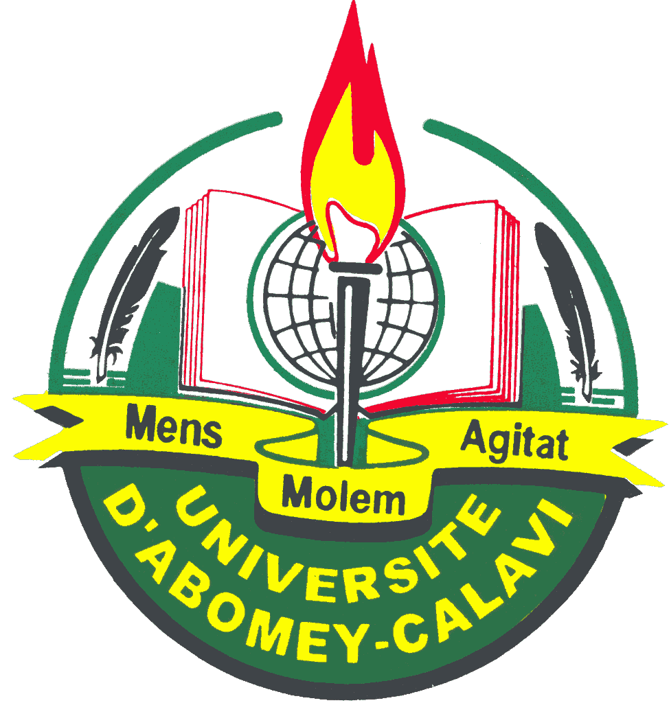
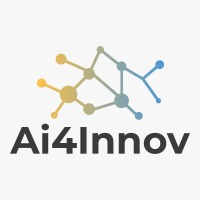

I’m a computer science student at IFRI, [University of Abomey-Calavi](https://www.uac.bj/), [Benin](https://www.benin.bj/en), graduating in December 2026. 
During my undergrad, I had a fun stint at [LRSIA](https://uac-rrteam.github.io/en), under Dr. [Vinasétan Ratheil Houndji](https://scholar.google.com/citations?hl=en&user=36wbP8kAAAAJ) modeling planning and routing problems with combinatorial optimization.
I also spent a summer under Dr. [Jeremiah Olamijuwon](https://scholar.google.com/citations?user=qH3ARpsAAAAJ&hl=en) working on NLP to detect churn signals for insurance companies at [eTihuku](https://www.etihuku.com/). 

I'm now a Research Engineer at [Ai4Innov Technologies](https://www.ai4innov.com/) working on geospatial AI under Dr. [Gilles Hacheme](https://scholar.google.com/citations?hl=en&user=yMMUBIUAAAAJ).

I'm currently a prospective M.Sc./PhD student in Applied Mathematics, Computer Science or Industrial Engineering for Fall 2027.
I'm curious about research in machine learning, computer vision and combinatorial optimization with applications
in healthcare, environment (e.g,  agriculture, climate change), and industry.