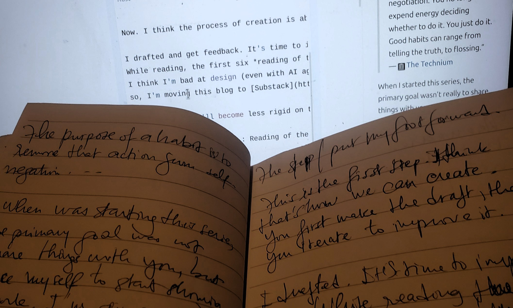

The first seven editions of Reading of the week are collected here. New editions are on [Substack](https://substack.com/@perrierbehoundja).

<section id="edition-1" class="reading-edition">

Edition #1

<ul>
<li><a href="https://calvinrosser.com/what-do-you-want/">What Do You Want?</a> — Calvin Rosser</li>
<li><a href="https://www.themarginalian.org/2024/10/22/marginalian-18/">18 Life-Learnings from 18 Years of The Marginalian</a> — Maria Popova</li>
<li><a href="https://complexityincs.com/">Complexity in Computer Science</a></li>
<li><a href="https://stephango.com/love">Love</a> — Steph Ango</li>
<li><a href="https://stephango.com/style">Style</a> — Steph Ango</li>
<li><a href="https://stephango.com/optimism">Optimism</a> — Steph Ango</li>
<li><a href="https://nightingal3.github.io/blog/2025/05/13/working-outdoors/">Underrated Life Hack: Working Outdoors</a> — Emmy Liu</li>
<li><a href="http://joschu.net/blog/opinionated-guide-ml-research.html">An Opinionated Guide to ML Research</a> — John Schulman</li>
<li><a href="https://www.alignmentforum.org/s/5GT3yoYM9gRmMEKqL">How I Think About My Research Process</a> — Neel Nanda</li>
<li><a href="https://www.criticalracedigitalstudies.com/peoplesguide">A People's Guide to Finding Algorithmic Bias</a></li>
<li><a href="https://www.phrasebank.manchester.ac.uk/introducing-work/">Introducing Work</a> — Academic Phrasebank</li>
<li><a href="https://github.com/chinasatokolo/academic_writing">Academic Writing</a></li>
<li><a href="https://www.aehnetwork.org/textbook/">The History of African Development</a></li>
</ul>

</section>
<section id="edition-2" class="reading-edition">

Edition #2

This week, I didn't have enough readings. Here are a few articles and resources that I found interesting.

<ul>
<li><a href="https://thoughtforms.life/what-advice-do-i-give-to-my-students/">What advice do I give to my students?</a> - Michael Levin</li>
<li><a href="https://paulgraham.com/own.html">A project of one's own</a> - Paul Graham</li>
<li><a href="https://x.com/camp4/status/1992958445885198805">Today I turn 55</a> - Kevin Dahlstrom</li>
<li><a href="https://www.sciencedirect.com/science/article/pii/S2589004219303554">Managing Ideas, People, and Projects: Organizational Tools and Strategies for Researchers</a> - Pascal &amp; Michel Levin</li>
<li><a href="https://x.com/richa_lq/status/2092399226370318377?s=20">Pushing your thinking abilities further</a> - Richa Sharma</li>
<li><a href="https://emilkowal.ski/ui/developing-taste">Developing Taste</a> - Emil Kowalski</li>
<li><a href="https://paulgraham.com/hs.html">What You'll Wish You'd Known</a> - Paul Graham</li>
<li><a href="https://usefulfictions.substack.com/p/how-to-be-more-agentic">How to be more agentic - On a supposedly difficult thing</a> - Cate Hall</li>
</ul>

</section>
<section id="edition-3" class="reading-edition">

Edition #3

Hello, dear reader!

I hope you’ve had a good week.

Last week, I mentioned that I hadn’t had much time for reading, and I promised I’d make up for it this week. Well, sometimes, even with the best intentions, we don’t quite manage to keep our promises.

Once again, I didn’t have as much time to read this week as I would have liked.

Until I can get back into a more regular rhythm — or perhaps find a better approach to my reading — here are a few articles and resources I came across and found interesting this week.

<ul>
<li><a href="https://www.technologyreview.com/2014/10/20/169899/isaac-asimov-asks-how-do-people-get-new-ideas">How do people get new ideas?</a>, by Isaac Asimov</li>
<li><a href="https://expandingawareness.org/blog/the-appropriate-amount-of-effort-is-zero/">The Appropriate Amount of Effort is Zero</a>, by Michael Ashcroft</li>
<li><a href="https://mindingourway.com/caring-about-some/">Caring About Some</a>, by Noah Sores</li>
<li><a href="https://mindingourway.com/rest-in-motion/">Rest in Motion</a>, by Noah Sores</li>
<li><a href="https://lifebythesea.bearblog.dev/how-to-follow-the-passion-without-the-passion/">How to Follow the Passion Without the Passion</a></li>
<li><a href="https://ckarchive.com/b/xmuph6hrzxwrd">How to get out of a rut</a>, by The Imperfectionist</li>
</ul>

<em><strong>NB:</strong> The em dashes (—) were not generated by AI :&gt;</em>

</section>
<section id="edition-4" class="reading-edition">

Edition #4

Dear person who consults my blog once a week,

I spent most of this week doing something I have become surprisingly good at: avoiding my to-do list.

Today is supposed to be my last day of holidays. And, as you may have noticed from the previous edition, I used this time off to think. Perhaps a little too much. About life and its purpose, its challenges, love, people, the future, and all those questions that rarely come with neat answers.

Next week will be a transition week. I’ll slowly try to find my way back to work, back to routines, back to the things that have been patiently waiting for me on that aforementioned to-do list.

But I intend to keep this Sunday ritual going. The nature of what I share here might shift a little as work takes over again. You can probably expect more technical articles to find their way into my weekly readings, but the ritual itself remains.

For now, I wish you a happy Sunday, and a gentle return to everyone who, like me, is reaching the end of their holidays.

May the transition be kind to us.

Happy reading.

<ul>
<li><a href="https://haksoat.com/lessons-from-my-father/">Lessons from my father</a>, by Habeeb Shopeju,</li>
<li><a href="https://paulgraham.com/words.html">Putting ideas into words</a>, by Paul Graham,</li>
<li><a href="https://pinchen.me/blog/about-being-in-the-present">About being present</a>, by Pin Chen,</li>
<li><a href="https://abdulhamidhassan.com/post/802639397650612224/may-your-life-be-difficult">May your life be difficult</a>, by Abdul Hamid Hassan,</li>
<li><a href="https://conquer1.substack.com/p/how-to-force-your-brain-to-crave-doing">How to force your brain to crave doing hard things</a>, by Conquer,</li>
<li><a href="https://daneden.me/blog/2014/words">Mouth words, Brain words</a>, by Daniel Eden,</li>
<li><a href="https://daneden.me/blog/2021/thinking-is-work">Thinking is work</a>, by Daniel Eden,</li>
<li><a href="https://cs.nyu.edu/~anupamg/speaking.html">Speaking skills</a>, by Anupam Gupta,</li>
<li><a href="https://archive.nytimes.com/opinionator.blogs.nytimes.com/2013/06/15/i-know-what-you-think-of-me/">I know what you think of me</a>, by Tim Kreider,</li>
<li><a href="https://en.wikipedia.org/wiki/Illusory_truth_effect">Illusory truth effect</a>, by Wikipedia,</li>
</ul>

One last thing before I leave you to your Sunday.

Two lines from Habeeb Shopeju’s Lessons from my father stayed with me this week:

<ol>
<li>&quot;<em><strong>Do not leave till tomorrow what you can do today.</strong></em>&quot;,</li>
<li>&quot;<em><strong>A bad workman always blames his tools.</strong></em>&quot;</li>
</ol>

Considering how successfully I spent this week avoiding my to-do list, the first one felt particularly well-timed.

See you next Sunday.

</section>
<section id="edition-5" class="reading-edition">

Edition #5

<strong>Dear Sunday reader,</strong>

I hope going back to your usual routine was not too hard.

As for me, I got caught up with some things that were still on my holiday to-do list. So :) I went on a little trip again. But now it’s over (I promise!).

But that’s not all.

Have you ever wondered if you are asking yourself the right questions?

If the ideal you have in mind is really the right one? Or maybe a little biased?

If the choices you made, are making, or will make are really the best ones?

When should your own happiness come before everything else (I’m talking about money here, haha), and when should it be the opposite? How much should you trust your instinct?

And most importantly! When should you choose what is better for the long term instead of an immediate reward?

These are the questions I’ve been thinking about at the end of this week. I’m still thinking about them, but I already have a first conclusion.

Even if we ask ourselves all these questions, deep down, I think we often know what we want to do.

But because we are afraid of disappointing others, afraid that people will not understand our choices, or sometimes because we are not sure enough about what we really want, we look for excuses.

Maybe the difficult part is not always knowing what to do. Maybe it is accepting what comes with our decision.

While waiting to see the consequences — hopefully good ones :) — of our choices, I invite you to discover my reading list for this week. (I’m still reading some of them :&gt;)

Happy reading, and have a good week!

<ul>
<li><a href="https://nat.org/">Some things I believe</a>, Nat Friedman</li>
<li><a href="http://www.aaronsw.com/weblog/semmelweis">Look at yourself objectively</a>, Aaron Swartz</li>
<li><a href="https://www.notboring.co/p/means-and-meaning">Means and meaning</a>, Packy McCormick</li>
<li><a href="https://www.theguardian.com/lifeandstyle/2020/sep/04/oliver-burkemans-last-column-the-eight-secrets-to-a-fairly-fulfilled-life">The eight secrets to a (fairly) fulfilled life</a>, Oliver Burkeman</li>
<li><a href="https://cs.nyu.edu/~anupamg/writing.html">Resources for writing</a>, Anupam Gupta</li>
<li><a href="https://cs.nyu.edu/~anupamg/speaking.html">Speaking Skills Talks</a>, Anupam Gupta</li>
<li><a href="https://ludwigabap.com/posts/on-comparing-yourself-to-brilliant-people/">On comparing yourself to brilliant people</a>, Ludwiga Bap</li>
<li><a href="https://danielchechick.substack.com/p/why-intelligent-people-often-struggle">Why intelligent people often struggle with love</a>, Daniel Chechick</li>
<li><a href="https://suryakasturi.com/2026060500">A World Where Everything Becomes A Little Alive</a>, Surya Kasturi</li>
<li><a href="https://fs.blog/great-talks/richard-hamming-your-research/">You and your research</a>, Richard Hamming</li>
<li><a href="https://henryhmko.github.io/non-technical/posts/gap_year/gap_year.html">What I Learned in My Gap Year</a>, Henry Ko</li>
<li><a href="https://henryhmko.github.io/non-technical/posts/years_to_come/years_to_come.html">For the years to come</a>, Henry Ko</li>
</ul>

<em><strong>NB:</strong> The em dashes (—) were not generated by AI :&gt;</em>

</section>
<section id="edition-6" class="reading-edition">

Edition #6

<strong>Greetings, dear person who stops by here on Sundays!</strong>

This week, I chased several rabbits at once.

I managed to catch up with some of them. Others are still running.

But among all those rabbits, none really looked like an article for the <em>Reading of the week</em>.

I did come across a few titles, open a few tabs, and promise myself I would return to them later. For now, though, those tabs are still patiently waiting for their turn.

So, there will be no reading list this week. And I think that is probably for the best: an empty list is better than one filled merely for the sake of keeping an appointment.

The appointment itself, however, remains.

I’ll see you again next week with, I hope, fewer rabbits to chase, a little more time to read, and a few articles genuinely worth sharing.

Have a lovely week.

See you next Sunday.

</section>
<section id="edition-7" class="reading-edition">

Edition #7

TL;DR: Check out on Substack:
<a href="https://perrierbehoundja.substack.com/p/reading-of-the-week-7?r=4ayd61&amp;utm_campaign=post&amp;utm_medium=web">Reading of the Week #7</a>

<blockquote>

“The purpose of a habit is to remove that action from self-negotiation. You no longer expend energy deciding whether to do it. You just do it. Good habits can range from telling the truth, to flossing.” 
— <a href="https://web.archive.org/web/20200429051533/https://kk.org/thetechnium/68-bits-of-unsolicited-advice/">The Technium</a>

</blockquote>

When I started this series, the primary goal wasn’t really to share things with you.

It was to force myself to start <strong>showing my work</strong>.

I’m shy on the internet. I’m afraid of external eyes, opinions, and being judged. And I needed to find a way to slowly break through that fear.

Since I read a lot on the internet — whenever I can — I thought: why not start by sharing some of the interesting articles sitting in my notes, bookmarks, and Notion lists?

It felt like a small enough first step.

Seven weeks later, I’m happy I took it.

And now I think I’m starting to understand creation as something like this:

<strong>Curiosity → Learning → Draft → Improvement → Feedback → More improvement → … → Eventually, something great.</strong>

I drafted. I published. I got feedback.

So now, it’s time to improve.

If you’ve read the first six editions of <em>Reading of the Week</em>, you may have noticed that the design of this website is… not exactly the best in the world 😅

I tried changing it almost every week.

I think I’m bad at design — even with AI agents helping me. But I have good taste. At least, I think I do.

So I’m moving the blog to <a href="https://substack.com/">Substack</a>.

A few friends have also been asking for things like comments, likes, and easier ways to interact with what I publish. So this might be the last article of mine that you can’t put a like on hahaha.

More importantly, Substack gives me a better ecosystem for the kind of blogging I want to do.

I’m also going to become less rigid about publishing frequency.

Until now, <em>Reading of the Week</em> created a useful constraint for me. It helped me build the habit. But I think I’m ready to be more spontaneous now — sharing more technical things, shorter thoughts, and reading lists whenever they feel worth sharing.

So the series is getting a new name:

<strong>Recent Reading.</strong>

And I’m starting today.

Check out on Substack:
<a href="https://perrierbehoundja.substack.com/p/reading-of-the-week-7?r=4ayd61&amp;utm_campaign=post&amp;utm_medium=web">Reading of the Week #7</a>

Now I have a new challenge. Here is a clue.

Regards,

Rosas

</section>
