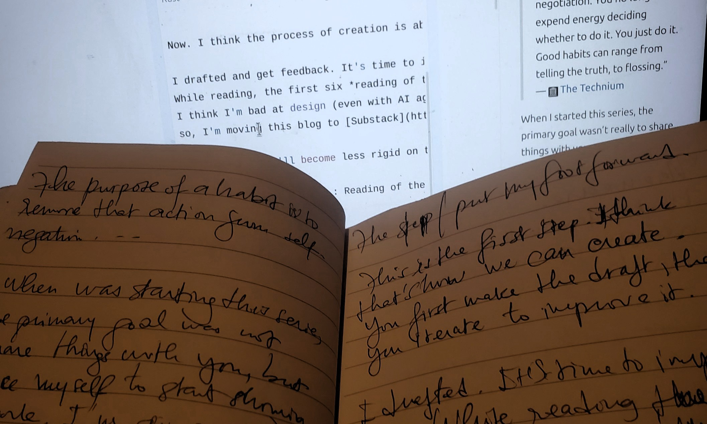

Les sept premières éditions de Reading of the week sont réunies ici. Les nouvelles éditions sont sur [Substack](https://substack.com/@perrierbehoundja).

<section id="edition-1" class="reading-edition">

Edition #1

<ul>
<li><a href="https://calvinrosser.com/what-do-you-want/">What Do You Want?</a> — Calvin Rosser</li>
<li><a href="https://www.themarginalian.org/2024/10/22/marginalian-18/">18 Life-Learnings from 18 Years of The Marginalian</a> — Maria Popova</li>
<li><a href="https://complexityincs.com/">Complexity in Computer Science</a></li>
<li><a href="https://stephango.com/love">Love</a> — Steph Ango</li>
<li><a href="https://stephango.com/style">Style</a> — Steph Ango</li>
<li><a href="https://stephango.com/optimism">Optimism</a> — Steph Ango</li>
<li><a href="https://nightingal3.github.io/blog/2025/05/13/working-outdoors/">Underrated Life Hack: Working Outdoors</a> — Emmy Liu</li>
<li><a href="http://joschu.net/blog/opinionated-guide-ml-research.html">An Opinionated Guide to ML Research</a> — John Schulman</li>
<li><a href="https://www.alignmentforum.org/s/5GT3yoYM9gRmMEKqL">How I Think About My Research Process</a> — Neel Nanda</li>
<li><a href="https://www.criticalracedigitalstudies.com/peoplesguide">A People's Guide to Finding Algorithmic Bias</a></li>
<li><a href="https://www.phrasebank.manchester.ac.uk/introducing-work/">Introducing Work</a> — Academic Phrasebank</li>
<li><a href="https://github.com/chinasatokolo/academic_writing">Academic Writing</a></li>
<li><a href="https://www.aehnetwork.org/textbook/">The History of African Development</a></li>
</ul>

</section>
<section id="edition-2" class="reading-edition">

Edition #2

Cette semaine, je n'ai pas eu assez de lectures. Voici les quelques articles et ressources que j'ai trouvé intéressants.

<ul>
<li><a href="https://thoughtforms.life/what-advice-do-i-give-to-my-students/">What advice do I give to my students?</a> - Michael Levin</li>
<li><a href="https://paulgraham.com/own.html">A project of one's own</a> - Paul Graham</li>
<li><a href="https://x.com/camp4/status/1992958445885198805">Today I turn 55</a> - Kevin Dahlstrom</li>
<li><a href="https://www.sciencedirect.com/science/article/pii/S2589004219303554">Managing Ideas, People, and Projects: Organizational Tools and Strategies for Researchers</a> - Pascal &amp; Michel Levin</li>
<li><a href="https://x.com/richa_lq/status/2092399226370318377?s=20">Pushing your thinking abilities further</a> - Richa Sharma</li>
<li><a href="https://emilkowal.ski/ui/developing-taste">Developing Taste</a> - Emil Kowalski</li>
<li><a href="https://paulgraham.com/hs.html">What You'll Wish You'd Known</a> - Paul Graham</li>
<li><a href="https://usefulfictions.substack.com/p/how-to-be-more-agentic">How to be more agentic - On a supposedly difficult thing</a> - Cate Hall</li>
</ul>

</section>
<section id="edition-3" class="reading-edition">

Edition #3

Salut, très cher(e) lecteur(trice) !

J’espère que vous avez passé une bonne semaine.

La semaine dernière, j’ai mentionné que j’avais manqué de temps pour mes lectures et j’avais promis de me rattraper cette semaine. Eh bien, il arrive parfois que, même avec la meilleure volonté du monde, on ne parvienne pas à tenir ses promesses.

Cette semaine encore, je n’ai pas eu le temps de lire autant que je l’aurais souhaité.

En attendant de retrouver un rythme plus régulier — ou peut-être une meilleure formule pour mes lectures —, je vous propose de découvrir quelques articles et ressources que j’ai trouvés intéressants cette semaine.

<ul>
<li><a href="https://www.technologyreview.com/2014/10/20/169899/isaac-asimov-asks-how-do-people-get-new-ideas">How do people get new ideas?</a>, by Isaac Asimov</li>
<li><a href="https://expandingawareness.org/blog/the-appropriate-amount-of-effort-is-zero/">The Appropriate Amount of Effort is Zero</a>, by Michael Ashcroft</li>
<li><a href="https://mindingourway.com/caring-about-some/">Caring About Some</a>, by Noah Sores</li>
<li><a href="https://mindingourway.com/rest-in-motion/">Rest in Motion</a>, by Noah Sores</li>
<li><a href="https://lifebythesea.bearblog.dev/how-to-follow-the-passion-without-the-passion/">How to Follow the Passion Without the Passion</a></li>
<li><a href="https://ckarchive.com/b/xmuph6hrzxwrd">How to get out of a rut</a>, by The Imperfectionist</li>
</ul>

<em><strong>NB</strong>: Les tirets cadratins (—) ne sont pas générés pas une IA :&gt;</em>

</section>
<section id="edition-4" class="reading-edition">

Edition #4

Chère personne qui consulte mon blog une fois par semaine,

J'ai passé une bonne partie de cette semaine à faire quelque chose dans lequel je suis devenu étonnamment bon : éviter ma to-do list.

Aujourd'hui est censé être mon dernier jour de vacances. Et, comme tu as pu le remarquer dans l'édition précédente, j'ai profité de ce temps pour réfléchir. Peut-être un peu trop. À la vie et son sens, ses défis, l'amour, les gens, le futur, et toutes ces questions qui ont rarement des réponses simples.

La semaine prochaine sera une semaine de transition. Je vais doucement essayer de retrouver le chemin du travail, mes habitudes, et toutes ces choses qui m'attendent patiemment sur cette fameuse to-do list.

Mais j'ai bien l'intention de continuer ce petit rituel du dimanche. La nature de ce que je partage ici changera peut-être un peu avec la reprise du travail. Il y aura probablement plus d'articles techniques dans mes lectures de la semaine, mais le rituel, lui, reste.

Pour l'instant, je te souhaite un bon dimanche, et une reprise en douceur à toutes celles et ceux qui, comme moi, arrivent à la fin de leurs vacances.

Que la transition soit douce avec nous.

Bonne lecture.

<ul>
<li><a href="https://haksoat.com/lessons-from-my-father/">Lessons from my father</a>, par Habeeb Shopeju,</li>
<li><a href="https://paulgraham.com/words.html">Putting ideas into words</a>, par Paul Graham,</li>
<li><a href="https://pinchen.me/blog/about-being-in-the-present">About being present</a>, par Pin Chen,</li>
<li><a href="https://abdulhamidhassan.com/post/802639397650612224/may-your-life-be-difficult">May your life be difficult</a>, par Abdul Hamid Hassan,</li>
<li><a href="https://conquer1.substack.com/p/how-to-force-your-brain-to-crave-doing">How to force your brain to crave doing hard things</a>, par Conquer,</li>
<li><a href="https://daneden.me/blog/2014/words">Mouth words, Brain words</a>, par Daniel Eden,</li>
<li><a href="https://daneden.me/blog/2021/thinking-is-work">Thinking is work</a>, par Daniel Eden,</li>
<li><a href="https://cs.nyu.edu/~anupamg/speaking.html">Speaking skills</a>, par Anupam Gupta,</li>
<li><a href="https://archive.nytimes.com/opinionator.blogs.nytimes.com/2013/06/15/i-know-what-you-think-of-me/">I know what you think of me</a>, par Tim Kreider,</li>
<li><a href="https://en.wikipedia.org/wiki/Illusory_truth_effect">Illusory truth effect</a>, par Wikipedia.</li>
</ul>

Une dernière chose avant de te laisser profiter de ton dimanche.

Deux phrases tirées de <em>Lessons from my father</em> de Habeeb Shopeju me sont restées en tête cette semaine :

<ol>
<li>&quot;<em><strong>Ne remets pas à demain ce que tu peux faire aujourd'hui.</strong></em>&quot;</li>
<li>&quot;<em><strong>Un mauvais ouvrier blâme toujours ses outils.</strong></em>&quot;</li>
</ol>

Vu le talent avec lequel j'ai évité ma to-do list cette semaine, la première tombe plutôt bien.

À dimanche prochain.

</section>
<section id="edition-5" class="reading-edition">

Edition #5

<strong>Cher lecteur du dimanche,</strong>

J’espère que la reprise a été douce avec vous.

Quant à moi, je me suis laissé rattraper par quelques cases encore non cochées de ma todo list des vacances. Et donc :) je suis un peu reparti en promenade. Mais bon, c’est fini à présent (promis !).

Mais ce n’est pas tout.

Vous est-il déjà arrivé de vous demander si vous vous posez les bonnes questions ?

Si votre idéal n’est pas, quelque part, erroné ? Biaisé ?

Si les choix que vous avez faits, que vous faites ou que vous ferez sont vraiment les meilleurs ?

Quand est-ce que votre propre épanouissement doit passer avant toute autre considération (je veux parler d’argent, haha), et quand faut-il faire l’inverse ? À quel point faut-il se fier à son instinct ?

Et surtout : quand faut-il miser sur le long terme plutôt que privilégier une récompense immédiate ?

Cette fin de semaine, ce sont ces questions qui ont occupé mon esprit et nourri mes réflexions. Je n’ai pas fini d’y penser, loin de là, mais j’en suis arrivé à une première conclusion : malgré toutes ces questions, au fond, nous savons souvent ce que nous voulons faire.

Seulement, par peur de décevoir les autres, par peur que nos choix ne soient pas compris, ou parfois simplement parce que nous ne sommes pas assez convaincus de ce qui nous fait envie, nous cherchons des excuses. Des raisons de repousser, de choisir autrement, ou de ne pas choisir du tout.

Peut-être qu’au fond, la vraie difficulté n’est pas toujours de savoir quoi faire, mais d’accepter ce que notre réponse implique.

En attendant que les conséquences — positives, je l’espère — de nos choix se manifestent, je vous invite à explorer la liste de mes lectures de cette semaine. (Je n’ai pas encore fini de tous les lire :&gt;)

Bonne lecture, et passez une belle semaine.

<ul>
<li><a href="https://nat.org/">Some things I believe</a>, Nat Friedman</li>
<li><a href="http://www.aaronsw.com/weblog/semmelweis">Look at yourself objectively</a>, Aaron Swartz</li>
<li><a href="https://www.notboring.co/p/means-and-meaning">Means and meaning</a>, Packy McCormick</li>
<li><a href="https://www.theguardian.com/lifeandstyle/2020/sep/04/oliver-burkemans-last-column-the-eight-secrets-to-a-fairly-fulfilled-life">The eight secrets to a (fairly) fulfilled life</a>, Oliver Burkeman</li>
<li><a href="https://cs.nyu.edu/~anupamg/writing.html">Resources for writing</a>, Anupam Gupta</li>
<li><a href="https://cs.nyu.edu/~anupamg/speaking.html">Speaking Skills Talks</a>, Anupam Gupta</li>
<li><a href="https://ludwigabap.com/posts/on-comparing-yourself-to-brilliant-people/">On comparing yourself to brilliant people</a>, Ludwiga Bap</li>
<li><a href="https://danielchechick.substack.com/p/why-intelligent-people-often-struggle">Why intelligent people often struggle with love</a>, Daniel Chechick</li>
<li><a href="https://suryakasturi.com/2026060500">A World Where Everything Becomes A Little Alive</a>, Surya Kasturi</li>
<li><a href="https://fs.blog/great-talks/richard-hamming-your-research/">You and your research</a>, Richard Hamming</li>
<li><a href="https://henryhmko.github.io/non-technical/posts/gap_year/gap_year.html">What I Learned in My Gap Year</a>, Henry Ko</li>
<li><a href="https://henryhmko.github.io/non-technical/posts/years_to_come/years_to_come.html">For the years to come</a>, Henry Ko</li>
</ul>

<em><strong>NB</strong>: Les tirets cadratins (—) ne sont pas générés pas une IA :&gt;</em>

</section>
<section id="edition-6" class="reading-edition">

Edition #6

<strong>Salutations, chère personne qui passe par ici le dimanche !</strong>

Cette semaine, j’ai couru après plusieurs lièvres à la fois.

Certains se sont laissé rattraper. D’autres courent encore.

Mais parmi tous ces lièvres, aucun ne ressemblait vraiment à un article pour le <em>Reading of the week</em>.

J’ai bien croisé quelques titres, ouvert quelques onglets et promis d’y revenir plus tard. Mais, pour l’instant, ces onglets attendent toujours patiemment leur tour.

Cette semaine, il n’y aura donc pas de liste de lectures. Et je crois que c’est mieux ainsi : une liste vide vaut probablement mieux qu’une liste remplie juste pour ne pas manquer un rendez-vous.

Le rendez-vous, lui, reste.

Je vous retrouve la semaine prochaine avec, je l’espère, un peu moins de lièvres à poursuivre, un peu plus de temps pour lire, et quelques articles qui valent réellement le détour.

Passez une belle semaine.

À dimanche prochain.

</section>
<section id="edition-7" class="reading-edition">

Edition #7

TL;DR : À lire sur Substack :
<a href="https://perrierbehoundja.substack.com/p/reading-of-the-week-7?r=4ayd61&amp;utm_campaign=post&amp;utm_medium=web">Reading of the Week #7</a>

<blockquote>

« Le but d’une habitude est de soustraire cette action à la négociation avec soi-même. On ne dépense plus d’énergie à décider s’il faut la faire ou non. On la fait, tout simplement. Les bonnes habitudes peuvent aller du fait de dire la vérité à celui de passer du fil dentaire. »
— <a href="https://web.archive.org/web/20200429051533/https://kk.org/thetechnium/68-bits-of-unsolicited-advice/">The Technium</a>

</blockquote>

Quand j’ai commencé cette série, l’objectif principal n’était pas vraiment de partager des choses avec vous.

C’était de me forcer à commencer à <strong>montrer mon travail</strong>.

Je suis timide sur Internet. J’ai peur du regard des autres, de leurs opinions et d’être jugé. Et j’avais besoin de trouver un moyen de dépasser progressivement cette peur.

Comme je lis beaucoup de choses sur Internet — dès que j’en ai l’occasion — je me suis dit : pourquoi ne pas commencer par partager quelques-uns des articles intéressants qui traînent dans mes notes, mes favoris et mes listes Notion ?

Ça me semblait être un premier pas suffisamment simple.

Sept semaines plus tard, je suis heureux de l’avoir fait.

Et maintenant, je commence à voir le processus de création comme quelque chose qui ressemble à ça :

<strong>Curiosité → Apprentissage → Brouillon → Amélioration → Feedback → Nouvelle amélioration → … → Jusqu’à obtenir quelque chose de vraiment bien.</strong>

J’ai écrit. J’ai publié. J’ai reçu des retours.

Alors maintenant, il est temps d’améliorer les choses.

Si vous avez lu les six premières éditions de <em>Reading of the Week</em>, vous avez peut-être remarqué que le design de ce site n’est… pas exactement le meilleur du monde 😅

J’ai essayé de le changer presque chaque semaine.

Je pense que je suis mauvais en design — même avec l’aide d’agents IA. Mais j’ai bon goût. Enfin, je crois.

Du coup, je déplace le blog sur <a href="https://substack.com/">Substack</a>.

Quelques amis me demandaient aussi des fonctionnalités comme les commentaires, les likes et des moyens plus simples d’interagir avec ce que je publie. Cet article sera donc peut-être le dernier sur lequel vous ne pourrez pas mettre de like hahaha.

Plus important encore, Substack m’offre un meilleur écosystème pour le type de blogging que j’ai envie de faire.

Je vais aussi être moins rigide sur la fréquence de publication.

Jusqu’ici, <em>Reading of the Week</em> m’imposait une contrainte utile. Ça m’a aidé à construire l’habitude. Mais je pense que je suis maintenant prêt à être plus spontané — à partager davantage de contenus techniques, de pensées courtes et de listes de lecture dès que j’estime qu’elles valent la peine d’être partagées.

La série change donc de nom :

<strong>Recent Reading.</strong>

Et je commence aujourd’hui.

À lire sur Substack :
<a href="https://perrierbehoundja.substack.com/p/reading-of-the-week-7?r=4ayd61&amp;utm_campaign=post&amp;utm_medium=web">Reading of the Week #7</a>

Maintenant, j’ai un nouveau défi. Voici un indice.

Bien à vous,

Rosas

</section>
